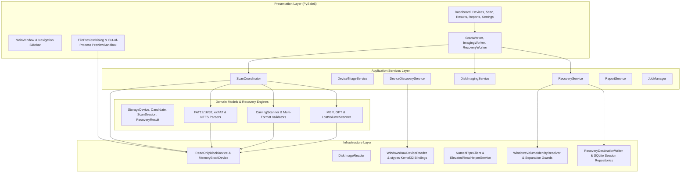

# RecoverX System Architecture

RecoverX is architected with a strict downward dependency hierarchy conforming to Clean Architecture and forensic software engineering principles.

---

## 1. Architectural Layers and Responsibilities

### A. Presentation Layer (`src/recoverx/presentation/`)
- **Technology:** PySide6 (Qt 6.12 for Python) running with per-monitor high-DPI scaling and custom dark palette styling.
- **Threading Model:** The UI thread runs the Qt event loop (`QApplication`) and never touches disk hardware or performs I/O directly.
  - Long-running operations (scanning, imaging, recovery) run in dedicated `QThread` instances managed by worker objects (`ScanWorker`, `ImagingWorker`, `RecoveryWorker`).
  - Progress updates and candidate discoveries are dispatched via Qt Signals (`pyqtSignal` / `Signal`) and queued slots, guaranteeing thread safety.
- **Untrusted Preview Isolation:**
  - Files recovered from damaged or untrusted media may contain exploits or malformed chunks.
  - All file decoding (decoding images, parsing SQLite, reading ZIP structures) executes in an isolated worker subprocess (`recoverx.presentation.preview.worker`) managed by `PreviewSandbox`.
  - The worker subprocess is constrained to a 10 MiB buffer, downscales images to 4096px max, and has a 3.0s hard timeout with process termination on timeout or crash.

### B. Application Services Layer (`src/recoverx/services/`)
- Encapsulates high-level use-cases and coordinates recovery workflows:
  - **`ScanCoordinator`:** Orchestrates the progressive 5-step recovery pipeline:
    1. *Device inspection:* Retrieves disk geometry, sector size, and total capacity.
    2. *Partition analysis:* Analyzes MBR and GPT partition tables.
    3. *Lost volume detection:* Probes unpartitioned space for VBR signatures.
    4. *Filesystem metadata parsing:* Recovers active and deleted files from FAT, exFAT, and NTFS structures.
    5. *Carving:* Executes chunk-based raw signature matching and extent validation for 17+ file formats.
    6. *Deduplication:* Prioritizes metadata candidates over carved files to eliminate duplicate recovery candidates.
  - **`DiskImagingService`:** Implements multi-pass acquisition (Phase 1 Copy, Phase 2 Split, Phase 3 Retry, Phase 4 Scrape) generating raw `.raw` disk images with bit-precise sector maps.
  - **`RecoveryService`:** Manages safe extraction to a separate destination with atomic staging (`.tmp` write followed by `os.replace`), Windows reserved filename sanitization, collision renaming, and cryptographic SHA-256 verification.
  - **`JobManager`:** Prevents concurrent conflicting operations on the same physical device or shared destination paths.

### C. Domain Models & Recovery Engines (`src/recoverx/domain/`, `src/recoverx/filesystems/`, `src/recoverx/carving/`)
- **Factual Domain Models:**
  - `RecoveryCandidate`: Immutable dataclass representing a recoverable file. Never reports speculative percentages; assigns factual `CandidateStatus` values (*METADATA_RECOVERED*, *SIGNATURE_MATCHED*, *PREVIEW_VALIDATED*, *PARTIALLY_READABLE*, *TRUNCATED*, *UNVERIFIED*, *FAILED*).
  - `StorageDevice` / `DeviceIdentity`: Captures vendor, product, serial number, sector0 SHA-256 hash, removable flag, and triage status.
- **Filesystem Parsers:**
  - `FatFileSystem`: FAT12, FAT16, and FAT32 boot sector, BPB, FAT table, and directory cluster chain recovery.
  - `ExFatFileSystem`: exFAT Volume Boot Record, Main/Backup boot checksums, Stream Extension entries, and Allocation Bitmap checks.
  - `NtfsFileSystem`: Primary and backup boot sectors, Update Sequence (Fixup) verification, MFT record parsing, compressed data-run decoding, and hierarchical path reconstruction.
- **Carving Engine:**
  - Fast chunk scanning using sliding window buffers with overlap regions equal to maximum file header lengths.
  - Format validators verifying internal structure, dimensions, and delimiters for JPEG, PNG, GIF, BMP, HEIC, TIFF/RAW, PDF, ZIP, 7z, MP4, WAV, AVI, MP3, and SQLite.

### D. Infrastructure Layer (`src/recoverx/infrastructure/`)
- **Read-Only Storage Contract (`ReadOnlyBlockDevice`):**
  - Defines the core storage interface: `size_bytes`, `logical_sector_size`, `read_at(offset, length)`, `close()`.
  - Exposes zero write, format, or repair methods.
- **Hardware Access (`WindowsRawDeviceReader`):**
  - Uses explicit, audited `ctypes` bindings to Windows `kernel32.dll`.
  - Strictly asserts `GENERIC_READ`, `FILE_SHARE_READ | FILE_SHARE_WRITE`, `OPEN_EXISTING`.
  - Enforces sector alignment and length bounds on every Win32 `ReadFile` call.
- **Elevated Read Helper (`ElevatedReadHelperService` & `NamedPipeClient`):**
  - Runs with administrative privileges via UAC `runas` only when elevated hardware handles are required.
  - Communicates over local named pipes (`\\.\pipe\recoverx_read_helper_*`).
  - Enforces strict message schema and bounds validation, exposing only `OPEN`, `READ`, `CANCEL`, `CLOSE` commands.
- **Identity & Separation Resolver (`WindowsVolumeIdentityResolver`):**
  - Uses `IOCTL_STORAGE_GET_DEVICE_NUMBER` and `IOCTL_VOLUME_GET_VOLUME_DISK_EXTENTS` to map volume paths to physical disk numbers.
  - Enforces CLAUDE.md Rules 2 & 3: Refuses recovery operations targeting the source volume or physical disk.

---

## 2. Security and Reliability Invariants

1. **Read-Only Invariant:** Hardware readers never open handles with `GENERIC_WRITE`. No write IOCTLs (`FSCTL_LOCK_VOLUME`, `FSCTL_DISMOUNT_VOLUME`) are ever issued.
2. **Strict Destination Separation:** Destructive in-place writes are impossible. All output directories must reside on a completely different physical disk or separate storage volume.
3. **Least Privilege Execution:** The GUI and carver run at standard user level (`asInvoker`). Elevation is localized to the small, audited read helper service.
4. **Resilience to Device Disconnection:** Hardware removal during reads triggers `DeviceDisconnectedError` without crashing the application or hanging threads.
