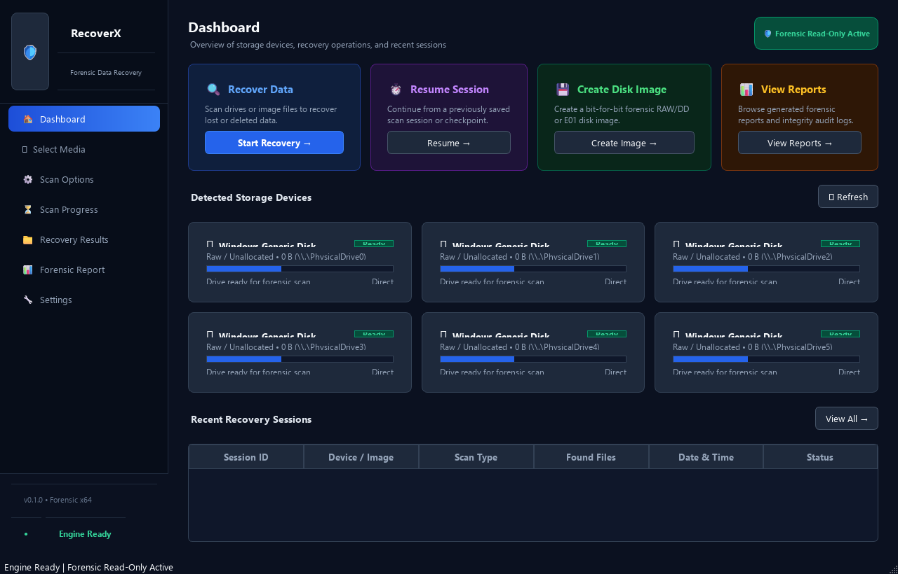
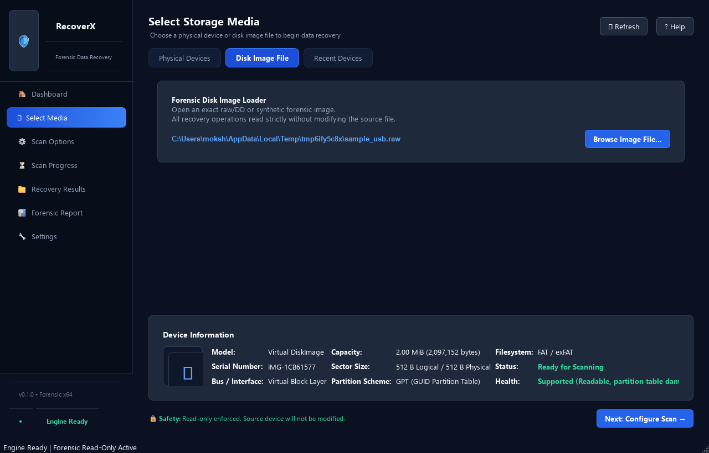
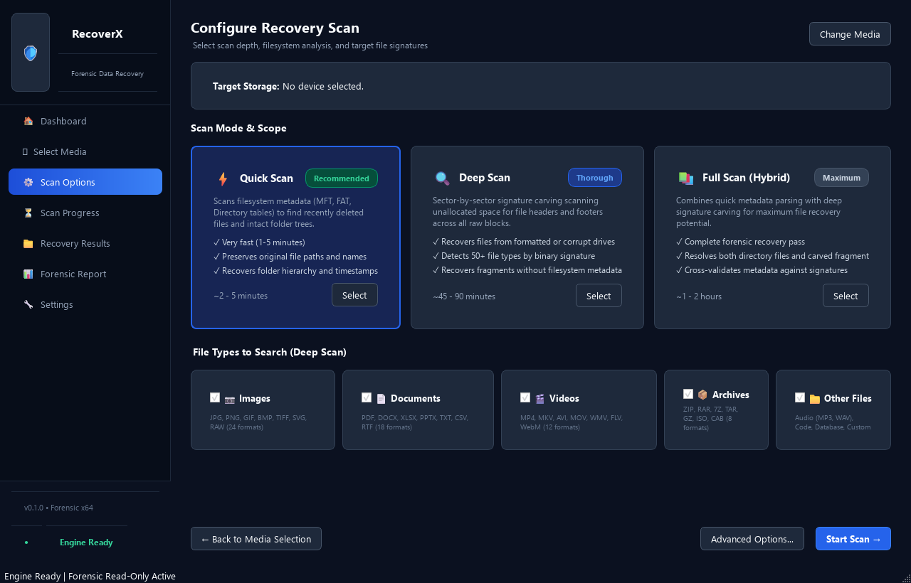
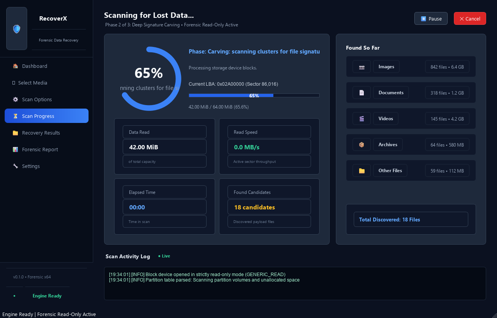
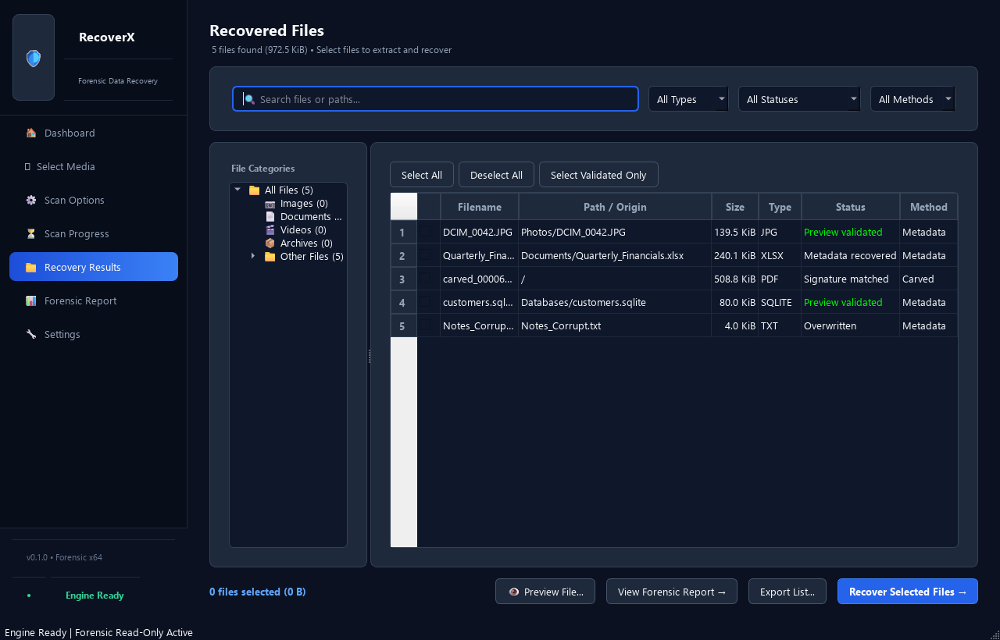
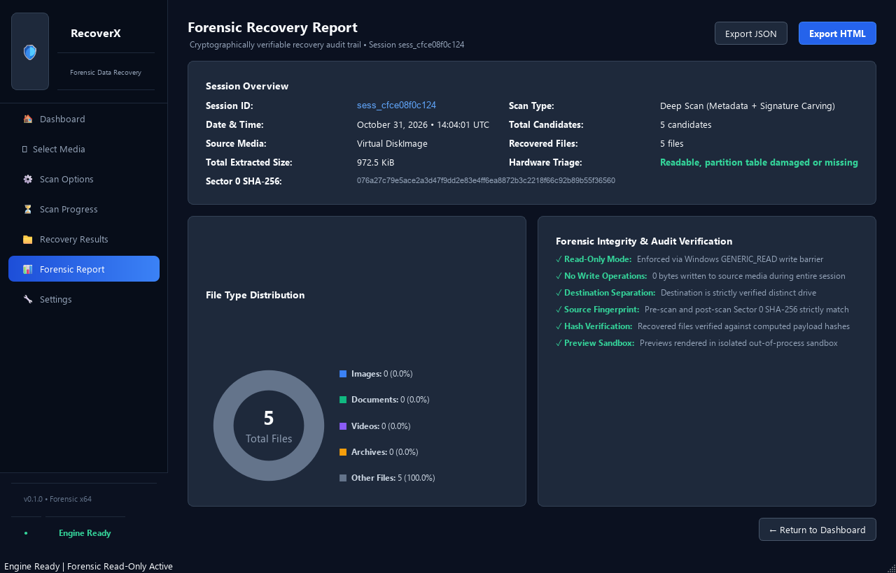
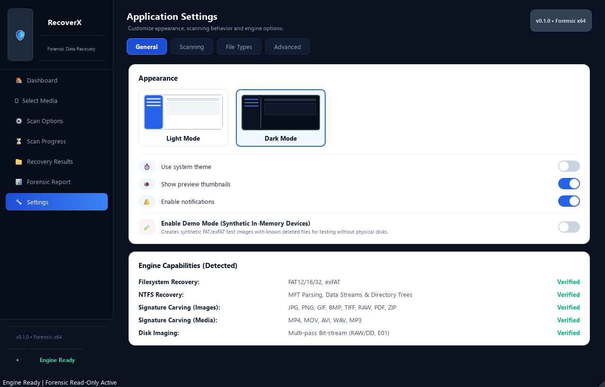

<p align="center">
  
</p>

<h1 align="center">RecoverX • Forensic Data Recovery Suite</h1>

<p align="center">
  <b>Production-grade, non-destructive data recovery suite for Windows 10/11 x64</b><br>
  Strict Read-Only Direct I/O • Multi-Filesystem Metadata Reconstruction (FAT12/16/32, exFAT, NTFS) • Deep Signature Carving • Cryptographic SHA-256 Auditing
</p>

<p align="center">
  <a href="https://www.microsoft.com/windows"></a>
  <a href="https://www.python.org/"></a>
  <a href="https://www.qt.io/"></a>
  <a href="SECURITY.md"></a>
  <a href="#downloads"></a>
</p>

---

## Overview

**RecoverX** is a local-first, forensic-grade Windows 10/11 x64 desktop data recovery application engineered specifically for removable block storage media (USB flash drives, SD/microSD cards, CF cards, external HDDs) and raw disk image files.

Built strictly under non-destructive invariants, RecoverX guarantees that source media are never modified or written to, while enforcing physical disk separation to prevent accidental overwrites of existing data.

---

## Application Screenshots & Visual Tour

### 1. Dashboard & Media Triage
Primary mission control overview featuring quick-action recovery cards, recently detected physical block devices with partition allocation bars, and instant session history.



---

### 2. Device Selection & Storage Triage
Non-destructive physical disk inspection and raw disk image loader (`.raw`, `.dd`, `.img`). Automatically inspects sector size, partition table scheme (MBR / GPT), filesystem geometry, and hardware read-barrier health.



---

### 3. Scan Mode & File Types Configuration
Choose recovery scan depth: **Quick Scan** (filesystem directory tables and allocation maps), **Deep Scan** (raw sector-by-sector signature carving), or **Full Scan (Hybrid)**. Filter across 17+ validated file types with sector-aligned boundary checks.



---

### 4. Real-Time Telemetry & Progress
Live 60 FPS radial progress gauge tracking sector sweep progress, current LBA cluster offset, streaming read throughput (MB/s), bad sectors encountered, and live forensic activity logs.



---

### 5. Recovery Results & Reconstructed Folder Tree
Explore recovered files organized by category or reconstructed original directory paths. Every candidate displays file size, detection method (*Metadata recovered* vs *Signature matched*), and factual integrity status. Includes search, filter, and multi-file extraction.



---

### 6. Cryptographic Audit & Forensic Report
Tamper-proof forensic session audit report detailing device serial numbers, pre-scan and post-scan Sector 0 SHA-256 integrity hashes, bad sector maps, and file type distribution. One-click export to interactive HTML and structured JSON.



---

### 7. Application Settings & Verified Engine Capabilities
Configure recovery engine parameters, toggle system appearance (**Dark Mode** / **Light Mode**), enable thumbnail previews, or activate **Demo Mode** (synthetic in-memory FAT/exFAT images for testing without physical drives).



---

## Key Features

- **Strictly Read-Only Operation:** Source devices are opened exclusively in read-only mode (`GENERIC_READ`). Hardware write, format, and partition modify commands are structurally prohibited.
- **Deep Filesystem Metadata Recovery (All Verified):**
  - **FAT12 / FAT16 / FAT32:** Recovers directory structures, cluster chains, and deleted directory entries (`0xE5`).
  - **exFAT:** Reconstructs full Unicode filenames up to 255 characters, timestamps, allocation bitmaps, and contiguous cluster streams.
  - **NTFS:** Parses primary and backup boot sectors, Update Sequence (Fixup) arrays, resident streams, and non-resident data runs with hierarchical directory tree walking.
- **Advanced File Carving (17+ Formats Across Images, Documents & Media):** High-speed sliding-window carver with dedicated structural and delimiter validators for:
  - *Images:* JPEG (with EXIF thumbnails), PNG, GIF, BMP, HEIC/AVIF, TIFF-based RAW (Canon CR2, Nikon NEF, Sony ARW, DNG).
  - *Documents & Archives:* PDF, ZIP, DOCX, XLSX, PPTX, 7-Zip.
  - *Audio & Video:* MP4, MOV, M4A, RIFF (WAVE, AVI), MP3.
  - *Databases:* SQLite 3.
- **Out-of-Process Preview Sandbox:** Decodes untrusted candidate files inside an isolated, killable subprocess with a 10 MiB buffer cap, 4096px downscale limit, and a 3.0s hard timeout to protect the system against crafted media exploits.
- **Multi-Pass Forensic Disk Imaging:** Implements a resilient ddrescue-style acquisition engine (Copy, Split, Retry, Scrape) to extract readable sectors from failing drives onto safe storage before analysis.
- **Strict Destination Separation:** Queries Windows IOCTLs to strictly block recovery operations targeting the source volume or physical disk.
- **Forensic Audit Reporting:** Exports interactive HTML and structured JSON reports containing device serial numbers, bad sector maps, format breakdowns, and SHA-256 hashes of all recovered files.

---

## Core Safety Rules (Never Relaxed)

1. **Read-Only Invariant:** Hardware readers never issue write commands or modifying IOCTLs.
2. **Physical Disk Separation:** Nothing RecoverX creates (recovered files, images, session databases, logs, temp files) goes on the source device or on any volume of the same physical disk.
3. **Factual Statuses Only:** No speculative percentage "recovery chances". File status is reported factually (*Metadata recovered*, *Signature matched*, *Preview validated*, *Partially readable*, *Truncated*, *Unverified*, *Recovery failed*).
4. **100% Offline & Private:** Zero network communication. No telemetry, analytics, or phone-home calls.

---

## Downloads

| Package | Format | Description |
| :--- | :--- | :--- |
| **[RecoverX Setup](website/downloads/RecoverX-Setup-v0.1.0.exe)** | `.exe` (~91 MB) | Official Windows Setup Installer. Installs in seconds, configures Desktop shortcuts, and launches automatically. |
| **[Microsoft Store Package](website/downloads/RecoverX-v0.1.0-Store.msix)** | `.msix` (~48 MB) | Windows App Package ready for sideloading or Microsoft Partner Center deployment. |
| **[Portable ZIP Archive](website/downloads/RecoverX-v0.1.0-Windows-x64.zip)** | `.zip` (~46 MB) | Zero-install standalone archive. Extract and run `recoverx.exe gui` directly. |

---

## Quick Start

### Running the Desktop GUI
```bash
recoverx gui
```

### Command-Line Interface (CLI)
```bash
# Scan a raw disk image for recoverable files
recoverx scan C:\forensics\usb_dump.raw

# Output discovered candidates as JSON
recoverx scan C:\forensics\usb_dump.raw --json

# Recover files to a safe separate destination
recoverx recover C:\forensics\usb_dump.raw D:\recovered_files --collision-policy rename

# Analyze partition tables (MBR/GPT) and lost volumes
recoverx partitions C:\forensics\usb_dump.raw

# Acquire a multi-pass forensic disk image
recoverx image \\.\PhysicalDrive1 D:\images\drive1_backup.raw
```

---

## Documentation Roadmap

| Document | Description |
| :--- | :--- |
| **[USER_GUIDE.md](USER_GUIDE.md)** | Step-by-step user manual with screenshots/ASCII workflows, CLI flags, and troubleshooting FAQ. |
| **[ARCHITECTURE.md](ARCHITECTURE.md)** | Detailed layer breakdown (Presentation -> Application -> Domain -> Infrastructure), threading model, and IPC helper architecture. |
| **[RECOVERY_LIMITATIONS.md](RECOVERY_LIMITATIONS.md)** | Factual explanation of logical deletion vs data overwrite, SSD TRIM mechanics, encryption, and the 5-step recovery safety checklist. |
| **[SECURITY.md](SECURITY.md)** | Security threat model, sandboxed preview decoding, elevated named-pipe protocol, and vulnerability reporting policy. |
| **[BUILDING.md](BUILDING.md)** | Complete instructions to build from source, package with PyInstaller onedir, compile Inno Setup installers, and code-sign with `signtool.exe`. |
| **[TESTING.md](TESTING.md)** | Test strategy, running unit/property/integration tests, synthetic image fixtures, and offscreen headless Qt configuration. |
| **[docs/MICROSOFT_STORE_DEPLOYMENT_GUIDE.md](docs/MICROSOFT_STORE_DEPLOYMENT_GUIDE.md)** | Step-by-step instructions for publishing the packaged MSIX application to the Microsoft Store. |
| **[docs/LICENSES.md](docs/LICENSES.md)** | Third-party dependency inventory and LGPLv3 dynamic linking compliance terms. |
| **[THIRD_PARTY_NOTICES.md](THIRD_PARTY_NOTICES.md)** | Full legal notices and license texts for Qt, PySide6, Python, Hypothesis, and other libraries. |
| **[CHANGELOG.md](CHANGELOG.md)** | Chronological history of all milestone deliverables (M1 through M13). |
| **[RELEASE_NOTES.md](RELEASE_NOTES.md)** | Release notes for RecoverX v1.0.0. |

---

## Development Setup

```powershell
# Create Python 3.12 virtual environment
uv venv --python 3.12
.venv\Scripts\activate

# Install in editable mode with development tools
uv pip install -e ".[dev]"
uv pip install pyinstaller

# Run verification checks
ruff check .
ruff format --check .
mypy src tests
pytest
```

---

## License

The RecoverX root repository is currently marked **"Owner to decide"** (see [LICENSE](LICENSE) and [docs/DECISIONS.md](docs/DECISIONS.md) ADR 019). All third-party libraries retain their original open-source licenses.
